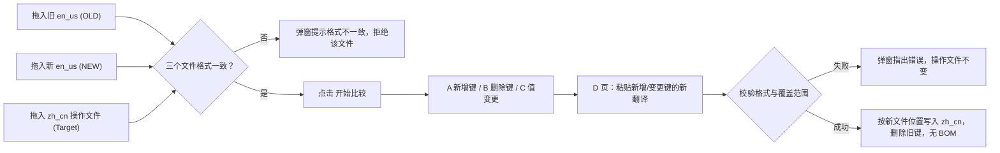
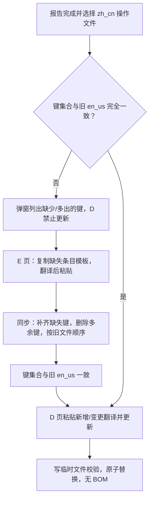
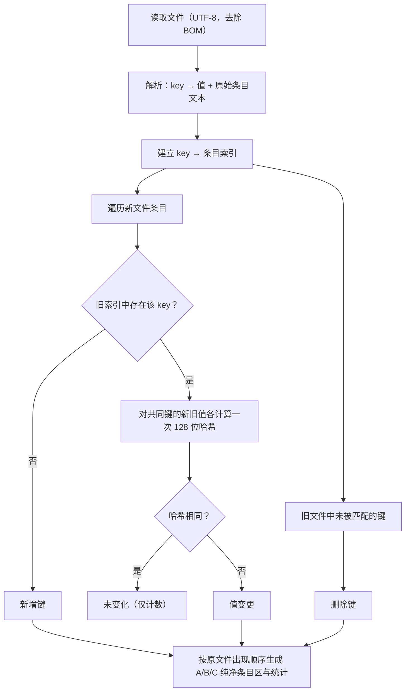

# MCLangDiff

MCLangDiff 是一个用于比较 Minecraft 模组语言文件并更新中文翻译的 Windows 桌面工具，使用 C++17 + Win32 API 编写。它可以比较同格式的旧/新 `en_us` 语言文件（`.json` 或 `.lang`），输出结构化差异报告，并在报告完成后把新增/变更键的新翻译按新文件位置写入 `zh_cn` 操作文件，同时删除已移除的旧键。

程序为单个 exe，静态链接 C/C++ 运行库，在 Windows 10/11 上无需安装额外运行时（仅依赖系统自带的 UCRT 与系统 DLL）。

## 功能特性

- 三个文件区：`旧文件 / Old (en_us)`、`新文件 / New (en_us)`、`操作文件 / Target (zh_cn)`，使用不同配色、徽标和左侧色条，避免拖错。
- 支持拖拽或点击选择文件；每个区域显示文件名、完整路径、角色（en_us/zh_cn）、格式（JSON/LANG）与大小。
- 支持分别清空三个区域的选择、交换新旧文件。
- 严格的输入校验：格式不一致、非 `.json`/`.lang`、文件不存在、空文件、区域之间选择同一文件、编码异常、JSON/LANG 语法错误、重复键等均给出明确提示。
- 比较结果分为三块：A. 新增键、B. 删除键、C. 值变更，并统计未变化键数量。
- 报告完成后提供 D 页“更新 zh_cn”：
  - 更新前先校验操作文件的键集合必须与旧 en_us 完全一致（顺序无关，必须一一对应）。
  - 不一致时弹窗列出缺少/多出的键，并禁止写入；需先通过 E 页同步。
  - 粘贴新增键与值变更键的新翻译条目，点击“更新文件”写回操作文件。
  - 写入前校验条目格式、覆盖范围、未知键与重复键；校验失败时禁止修改并弹窗指出具体行号/键名。
  - 新增/变更条目按新文件中的位置插入，值变更键的旧条目会被替换并重新定位，旧 en_us 中已删除的键会从操作文件删除。
  - 保留操作文件的其余条目、LANG 注释与换行风格；写回不包含 BOM；先写临时文件校验，再原子替换。
- 提供 E 页“同步 zh_cn”：当操作文件与旧 en_us 版本不一致时，展示可复制的缺失条目模板；粘贴缺失键的翻译条目后补齐缺失键并删除多余键，不要求任何值变更条目。同步完成后再使用 D 页更新到新版本。
- 每块内部严格分为“统计信息”和“纯净条目区”，条目区可直接复制或导出，不含说明文字。
- 保留 JSON 条目的原始缩进、键值空格写法和分隔符；保留 LANG 的 `key=value` 原文行。
- 所有条目按原文件出现顺序输出：新增/值变更按新文件顺序，删除按旧文件顺序。
- 比较在工作线程中执行，界面显示“正在比较…”与进度动画，大文件不冻结 UI；文件更新在点击“更新文件”后同步校验并原子写入。
- 支持“复制当前块”“复制全部报告”“导出报告（UTF-8 `.txt`，带 BOM，CRLF 换行）”。
- A/B/C 每个输出块右侧提供“复制本块”；所有输出框与粘贴框支持 Ctrl+A 全选、Ctrl+C 复制。
- 标签页与“更新/同步/复制模板”等按钮带悬停说明，明确新增/删除/变更相对哪个文件、操作哪个文件。
- 文件区下方与 E 页模板/粘贴框之间提供可拖动分隔条，可上下调整结果区高度与两框高度；文件区变矮时自动使用紧凑排版，避免文字裁切。
- 高 DPI 自适应：在 200% 缩放或小屏环境下自动切换紧凑布局；小屏启动时自动最大化。
- 提供命令行模式，便于脚本化或 CI 使用。

## 使用流程



操作步骤：

1. 将旧 `en_us` 语言文件拖入左侧 `旧文件 / Old` 区域，或点击该区域从文件对话框选择。
2. 将新 `en_us` 语言文件拖入中间 `新文件 / New` 区域。
3. 将待更新的 `zh_cn` 语言文件拖入右侧 `操作文件 / Target` 区域。三个文件必须同为 `.json` 或同为 `.lang`；操作文件可以稍后再选择。
4. 点击“开始比较”。比较期间按钮会禁用，状态行显示“正在比较…”。
5. 在 A/B/C 标签页查看差异；每页顶部是统计信息，下方是纯净条目区。
6. 切换到 `D. 更新 zh_cn`，粘贴新增键与值变更键的新翻译条目，点击“更新文件”。只有报告生成后才会显示 D 页。
7. 如果弹窗提示“操作文件与旧 en_us 的键集合不一致”，先切换到 `E. 同步 zh_cn`：复制缺失条目模板，翻译后粘贴到下方，点击“同步文件”。同步完成后回到 D 页继续更新。
8. 使用“复制当前块”复制当前差异块；使用“复制全部报告”或“导出报告”获取完整报告；使用清空/交换按钮调整文件选择。

## 构建

### 环境要求

- Windows 10/11 x64
- MinGW-w64 工具链：`g++` 与 `windres` 已加入 `PATH`
  - 已验证：llvm-mingw 20231128（clang 17，UCRT，x86_64）
  - MinGW-w64 GCC 亦可，构建命令保持相同
- 不使用 CMake，直接调用 MinGW 编译

### 一键构建

```bat
build.bat
```

输出：

```text
bin\MCLangDiff.exe        单文件可执行程序
build\app_res.o           资源中间文件
```

### 等价的完整命令

```bat
windres -I src -i src\app.rc -o build\app_res.o -O coff

g++ -std=c++17 -O2 -municode -mwindows ^
  -DUNICODE -D_UNICODE -D_WIN32_WINNT=0x0A00 -D_WIN32_IE=0x0A00 -finput-charset=UTF-8 ^
  -Wall -Wextra ^
  src\main.cpp src\app.cpp src\lang_file.cpp src\diff.cpp src\util.cpp src\update_file.cpp build\app_res.o ^
  -o bin\MCLangDiff.exe ^
  -static -static-libgcc -static-libstdc++ ^
  -lcomctl32 -lcomdlg32 -lshell32 -lgdi32 -luser32
```

说明：

- `-municode -mwindows` 用于 Unicode 入口与 GUI 子系统。
- `-static -static-libgcc -static-libstdc++` 静态链接编译器运行库，生成单 exe。
- `src\app.rc` 嵌入 `src\app.manifest`，启用 Common Controls v6 视觉样式、Per-Monitor V2 DPI 感知与长路径支持。
- 生成的 exe 仅导入 `COMCTL32.dll`、`comdlg32.dll`、`SHELL32.dll`、`GDI32.dll`、`USER32.dll`、`KERNEL32.dll` 与系统 UCRT 组件，不依赖 libstdc++/libc++/winpthread 等额外 DLL。

### 命令行模式

```bat
MCLangDiff.exe --text <旧文件> <新文件> <输出.txt>
MCLangDiff.exe --help
```

- 退出码：`0` 成功；`2` 比较失败；`3` 报告写入失败。
- 输出报告为 UTF-8（带 BOM）、CRLF 换行。
- 未提供参数时启动图形界面。

示例：

```bat
bin\MCLangDiff.exe --text samples\old.json samples\new.json tests\tmp\report.txt
```

## 报告结构

导出的报告由文件头与 A/B/C 三个区块组成。每个区块先输出统计信息，空一行后输出纯净条目区：

```text
MCLangDiff 语言文件差异报告
生成时间：2026-11-16 23:19:25
文件格式：JSON
条目顺序：新增/值变更按新文件出现顺序，删除按旧文件出现顺序
旧文件 / Old：D:\demo\old.json（715 B · 16 个键）
新文件 / New：D:\demo\new.json（768 B · 17 个键）
汇总：新增 3 · 删除 2 · 值变更 2 · 未变化 12 · 耗时 <1 ms

============================================================
[A] 新增键 / Added
统计：新增键 3 个 · 条目 3 条 · 来源：新文件

  "block.demo.new_block.name": "新方块",
  "gui.demo.settings": "设置",
  "item.demo.new_only.name" : "仅存在于新文件"

============================================================
[B] 删除键 / Removed
统计：删除键 2 个 · 条目 2 条 · 来源：旧文件

  "gui.demo.legacy": "旧版按钮",
  "item.demo.old_only.name": "仅存在于旧文件"

============================================================
[C] 值变更 / Changed
统计：值变更 2 个 · 旧条目 2 条 / 新条目 2 条

旧 / Old
  "item.demo.pickaxe.name": "演示镐"
新 / New
  "item.demo.pickaxe.name": "演示镐（强化）"

旧 / Old
  "gui.demo.close": "关闭"
新 / New
  "gui.demo.close": "关闭界面"
```

输出规则：

- 新增块：输出新文件中对应条目的原始文本。
- 删除块：输出旧文件中对应条目的原始文本。
- 值变更块：每个键分别输出旧条目原文与新条目原文，并标注 `旧 / Old` 与 `新 / New`。
- JSON 条目保留原缩进、冒号两侧空格等写法；条目之间以 `,\n` 连接，不做额外格式化，不添加外层花括号，不添加末尾逗号。
- LANG 条目保持原始 `key=value` 行，不做重新序列化。
- 未变化键只统计数量，不逐条列出。

## 更新 zh_cn 操作文件

### 前提

- 已选择旧/新 en_us，并生成 A/B/C 报告。D/E 页只在报告生成后出现。
- 已选择 `zh_cn` 操作文件，且与报告同为 `.json` 或同为 `.lang`。
- 操作文件的键集合必须与旧 en_us 完全一致（顺序无关，每个键一一对应）。不一致时 D 页会拒绝更新并提示先使用 E 页同步。

### 版本一致性检查

点击 D 页“更新文件”时，先比较操作文件与旧 en_us 的键集合：

- 一致：继续校验粘贴内容并写入。
- 操作文件缺少旧键或多出额外键：弹窗列出缺少/多出的键，禁止写入，并提示先到 E 页同步。
- 操作文件已与新 en_us 一致：提示无需再次更新。
- 操作文件读取失败：弹窗显示具体错误。

### E 页：同步操作文件到旧 en_us

E 页用于把“旧版本或部分翻译”的操作文件对齐到旧 en_us：

- “缺失条目模板”是纯净条目区，按旧 en_us 顺序列出缺失键及其英文原文，可直接复制或点击“复制模板”。
- 将模板中的值翻译后，粘贴到“粘贴已翻译的缺失条目”框，点击“同步文件”。
- 同步只校验“缺失键是否全部覆盖”，不要求任何值变更条目；操作文件中多余的键会被自动删除。
- 同步按旧 en_us 顺序注入缺失条目，保留注释、换行风格与其余条目，写回不带 BOM。
- 同步后操作文件与旧 en_us 的键集合一致，再回到 D 页更新到新 en_us。
- 示例 `samples/zh_cn.*` 故意保留了旧版本的部分键与一个多余键，用于演示 E 页同步流程。

### 粘贴内容

D 页只接受“新增键”和“值变更键”的新翻译。新增 3 个、变更 2 个时需要粘贴 5 条；粘贴顺序不限。

JSON 示例（可带外层 `{}`，可带末尾逗号）：

```json
"block.demo.new_block.name": "新方块",
"gui.demo.settings": "设置",
"gui.demo.close": "关闭界面",
"item.demo.new_only.name" : "仅存在于新文件",
"item.demo.pickaxe.name": "演示镐（强化）"
```

LANG 示例：

```lang
block.demo.new_block.name=新方块
gui.demo.settings=设置
gui.demo.close=关闭界面
item.demo.new_only.name=仅存在于新文件
item.demo.pickaxe.name=演示镐（强化）
```

注意：

- 不要粘贴报告 C 块中的“旧 / Old”部分；同一个键出现两次会被拒绝。
- 不允许粘贴不在“新增/值变更”集合中的键。
- 缺少任一必需键会被拒绝。
- 如果本次没有新增/变更但有删除，可以留空粘贴框，直接更新以删除旧键。

### 校验与错误

点击“更新文件”后依次校验：

1. 报告与操作文件存在，格式一致。
2. 粘贴块语法（JSON 字符串/转义/逗号；LANG 的 `key=value`）。
3. 每个键都必须属于“新增 + 值变更”集合。
4. 不允许重复键。
5. 必须覆盖全部必需键。

任一步失败都会弹窗列出具体问题（行号、键名、缺少列表），并禁止修改操作文件。

### 写入规则

- 删除：旧 en_us 有、新 en_us 没有的键，从操作文件中删除（若存在）。
- 取出：操作文件中属于“新增/值变更”的旧条目先移除。
- 定位：按新 en_us 顺序，把新条目插入到最近的、已存在的前一个键之后；若没有前一个键，则插入到首个条目之前。
- 保留：其余条目、LANG 注释/空行、目标的换行风格与末尾换行状态。
- JSON：未涉及条目保留原始前导空白与条目原文；插入条目使用目标的主导缩进；逗号按最终顺序重建。
- LANG：插入行使用目标的主导换行（CRLF/LF）；原有行的换行保持不变。
- 编码：读取时允许并忽略 BOM；写回始终为 UTF-8 且不带 BOM。
- 原子性：先写同目录临时文件并用同一解析器校验，通过后替换目标；失败时删除临时文件，目标文件不变。
- 不生成自动备份；建议在版本控制下使用。

### 更新流程



### 更新统计

成功后 D 页与状态行显示：

- 新增：操作文件中原本不存在的必需键数量。
- 更新：操作文件中已存在、被替换并重新定位的必需键数量。
- 删除：实际删除的旧键数量。
- 当前：更新后的条目总数。

## 比较规则

### 文件格式与编码

| 项目 | 规则 |
| --- | --- |
| 格式识别 | 按扩展名识别，大小写不敏感，仅接受 `.json` 与 `.lang` |
| 格式一致性 | 已选择的三个文件必须同格式，否则报错并拒绝；只选旧/新时两者也必须同格式 |
| 区域唯一性 | 旧文件、新文件、操作文件三个区域不能选择同一个文件 |
| 编码 | 按 UTF-8 严格校验；允许 UTF-8 BOM；拒绝 UTF-16/UTF-32、非法 UTF-8、NUL 字符 |
| 空文件 | 0 字节文件报错；仅含 BOM 的文件同样视为空 |
| 文件大小 | 单文件上限 512 MB |
| 文件读取 | 以共享读方式打开，允许其他程序同时读取 |

### JSON 文件

- 顶层必须是对象，形式为扁平的 `"key": "value"`。
- 值必须是字符串；数组、对象、数字、布尔值等会触发“值必须是字符串”的错误提示。
- 支持 JSON 转义：`\" \\ \/ \b \f \n \r \t \uXXXX`，包括代理对（如 `\uD83D\uDE00`）。
- 转义后的值参与比较。例如旧文件写作 `"\u4e2d\u6587"`、新文件写作 `"中文"`，两者视为未变化。
- 保留每条目的原文片段（从键的起始引号到值的结束引号）与行首缩进，用于报告输出。
- 解析错误会报告具体行号与原因（如缺少逗号、缺少冒号、对象末尾多余逗号、字符串未闭合、无效转义等）。
- 重复键视为错误，并报告重复键首次出现的行号。

### LANG 文件

- 每行格式为 `key=value`。
- 以 `#` 或 `//` 开头的行视为注释，空行忽略。
- 键两侧的空白会被裁剪；值保留 `=` 之后的原始内容（包括前导空格），比较与输出均按原文处理。
- 缺少 `=`、键为空、重复键均会报错并报告行号。
- 注释与空行不参与比较，也不进入报告。

### 条目顺序

- 新增键：新文件中的出现顺序。
- 删除键：旧文件中的出现顺序。
- 值变更：新文件中的出现顺序。
- 未变化：仅计数，不输出。

### 值相等判定与哈希

- 对共同键的新旧值分别计算一次 128 位哈希（双 64 位通道），比较哈希即可。
- 哈希基于 UTF-8 字节计算，中文、符号、空白均参与运算。
- 本项目按需求不实现“哈希相同后再做完整字符串比较”的回退；128 位哈希的理论碰撞概率约为 `2^-128`，在语言文件场景下可忽略。
- 相同键的判定使用完整键字符串比较（`unordered_map` 索引），不受哈希碰撞影响。

## 性能设计



主要优化点：

- 整个文件一次性读入连续缓冲区，解析结果使用 `std::string_view` 引用缓冲区，避免逐条字符串拷贝。
- 只有包含转义的 JSON 字符串才会解码并存入稳定的 `std::deque<std::string>` 存储区，普通字符串零拷贝。
- `key → 条目索引` 使用 `unordered_map`，共同键查找为平均 O(1)，整体复杂度 O(n + m)，不存在 O(n²) 比较。
- 每个共同键的新旧值只哈希一次，不重复计算。
- 解析时一次性预留条目数组与索引容量；生成报告前按条目原文长度预留输出缓冲。
- 条目顺序由解析顺序天然保证，报告生成阶段无需额外排序。
- 差异比较、解析、报告生成全部在工作线程执行，UI 线程只负责状态与结果展示。
- 128 位哈希使用 64×64→128 位乘法（MUM）与最终雪崩混合，单次遍历，适合短字符串与 UTF-8 文本。
- 界面采用双缓冲绘制与 `WS_CLIPCHILDREN`，避免闪烁；高 DPI 下按 DIP 计算布局与字号。

参考性能数据（开发机，Windows 11，200% DPI）：

| 数据 | 规模 | 比较耗时（含报告生成） |
| --- | --- | --- |
| JSON | 50,000 键 / 约 3.0 MB，450 处变更、500 新增、50 删除 | 约 29 ms |
| LANG | 50,000 键 / 约 2.6 MB，450 处变更、500 新增、50 删除 | 约 26 ms |

实际耗时与硬件、磁盘缓存、命中率有关。可使用 `tests\generate_large_samples.py` 生成大文件复测。

## 测试

测试脚本位于 `tests\`，包含核心逻辑测试与 CLI 集成测试。

```powershell
powershell -NoProfile -ExecutionPolicy Bypass -File tests\run_tests.ps1
```

脚本执行内容：

1. 调用 `build.bat` 构建应用。
2. 编译 `tests\core_tests.cpp`（链接解析、比较与工具模块）。
3. 运行 298 项核心检查：哈希稳定性、JSON/LANG 解析、原文保留、顺序、中文与转义、Unicode 等价、格式/编码/语法/重复键等错误路径，以及粘贴块解析、覆盖校验、操作文件与旧 en_us 的键集合一致性、缺失/多余键检测、E 页同步、JSON/LANG 按新文件位置注入、删除旧键、注释与 CRLF 保留、无 BOM、失败不写入等更新逻辑。
4. 通过 `--text` 生成 JSON 与 LANG 报告，检查 A/B/C 区块、统计数字、条目内容、出现顺序、UTF-8 BOM 与 CRLF。
5. 检查错误场景退出码：格式不一致、新旧同一文件、文件不存在。

大文件性能测试：

```powershell
python tests\generate_large_samples.py 50000
bin\MCLangDiff.exe --text tests\tmp\large_old.json tests\tmp\large_new.json tests\tmp\large_report.txt
```

`tests\tmp\`、`build\` 与 `tests\tmp\*.exe` 为测试/构建产物，可随时删除并重新生成。

## 目录结构

| 路径 | 说明 |
| --- | --- |
| `build.bat` | MinGW 一键构建脚本 |
| `bin\MCLangDiff.exe` | 构建产物（单文件可执行程序） |
| `build\app_res.o` | 资源编译中间文件 |
| `src\main.cpp` | 程序入口、命令行模式 |
| `src\app.cpp` / `src\app.h` | Win32 界面、三个文件区、A/B/C/D/E 标签页、复制、导出、更新与同步操作文件 |
| `src\lang_file.cpp` / `src\lang_file.h` | 文件读取、编码校验、JSON/LANG 解析与索引 |
| `src\diff.cpp` / `src\diff.h` | 差异比较、统计信息、A/B/C 报告生成，保留源文件供更新使用 |
| `src\update_file.cpp` / `src\update_file.h` | 粘贴块解析、键集合一致性检查、E 页同步、按新文件位置生成更新内容、无 BOM 原子写入 |
| `src\hash.h` | 128 位 MUM 混合哈希 |
| `src\util.cpp` / `src\util.h` | UTF-8 校验与转换、文件写入、格式化工具 |
| `src\app.rc` / `src\app.manifest` | 版本信息、Common Controls v6、DPI 与长路径清单 |
| `samples\old.json` / `new.json` | JSON 示例：新增、删除、值变更、中文、转义、Unicode 等价 |
| `samples\old.lang` / `new.lang` | LANG 示例：注释、中文、值变更 |
| `samples\zh_cn.json` / `zh_cn.lang` | 操作文件示例：故意缺少部分旧键并包含一个多余键，用于演示 E 页同步 |
| `tests\core_tests.cpp` | 核心逻辑测试 |
| `tests\run_tests.ps1` | 构建 + 核心测试 + CLI 集成测试脚本（UTF-8 BOM） |
| `tests\generate_large_samples.py` | 大文件生成脚本 |
| `README.md` | 本文件 |

## 已知限制

- 仅支持扁平字符串 JSON；NeoForge 的富文本组件（数组/对象值）不支持。
- 重复键会被视为格式错误，而不是采用“后者覆盖”的宽松策略。
- `.lang` 的值不做空白裁剪，`key= 值` 与 `key=值` 会被视为不同的值。
- 值变更按整值判定，不提供占位符（`%s`、`%1$d`）级别的细粒度差异。
- 不扫描 jar/整合包目录，只比较用户指定的文件。
- 单文件上限 512 MB；报告在内存中生成，极大差异会占用相应内存。
- 按需求仅使用 128 位哈希判定值相等，不进行哈希碰撞回退；碰撞概率极低但非绝对为零。
- 更新操作文件时，粘贴内容必须严格覆盖全部新增/变更键，且不能包含未知键或重复键；不支持“只粘贴一部分，其余保持原样”。
- D 页更新要求操作文件与旧 en_us 的键集合完全一致；部分翻译或旧版本操作文件必须先用 E 页同步，不能直接跳过一致性检查。
- E 页同步只校验缺失键的覆盖情况，不校验翻译值是否与英文相同；请自行确保粘贴的是中文翻译而不是未翻译的模板值。
- 更新与同步均为原地原子替换，不生成 `.bak` 备份；建议将 `zh_cn` 文件纳入版本控制。
- JSON 更新会按条目重建逗号与前导空白；极特殊的排版（例如条目之间夹注释、单行多对象）可能被最小幅度规范化。
- LANG 更新保留注释、空行、换行风格与末尾换行状态；插入行使用目标文件的主导换行。
- 依赖 Windows 10/11 的 `GetDpiForWindow` 等 API，不支持 Windows 7/8。
- 界面文字以中文为主，旧/新区块与报告区块同时标注英文 `Old/New`、`Added/Removed/Changed`。

## 第三方与参考

- 第三方库：无。JSON 解析器与哈希均为项目内自行实现，便于静态编译与分发。
- 解析约定参考了开源项目 [Lavender3533/modlang](https://github.com/Lavender3533/modlang)（MIT）：`.lang` 支持 `#` 与 `//` 注释、键裁剪、值保留原文。仅参考约定，未复制其代码。
- 哈希实现参考了 MUM / xxHash / wyhash 一类混合思路，为独立实现，不保证与任何现有哈希算法结果一致。

## 构建与验证环境

- 操作系统：Windows 11
- 编译器：llvm-mingw 20231128，clang 17.0.6，目标 `x86_64-w64-windows-gnu`
- 资源编译器：`windres`
- 验证方式：`build.bat` 零警告构建；核心测试 298 项、CLI 集成测试 29 项全部通过；真实拖拽、比较、三文件校验、D 页版本不一致警告、E 页模板与同步、D 页更新、无 BOM 写回、复制本块、分隔条拖动与剪贴板复制经界面自动化验证；标签页与按钮已接入标准 Win32 Tooltip；报告导出使用同一写入函数，经 CLI 与核心测试验证。
